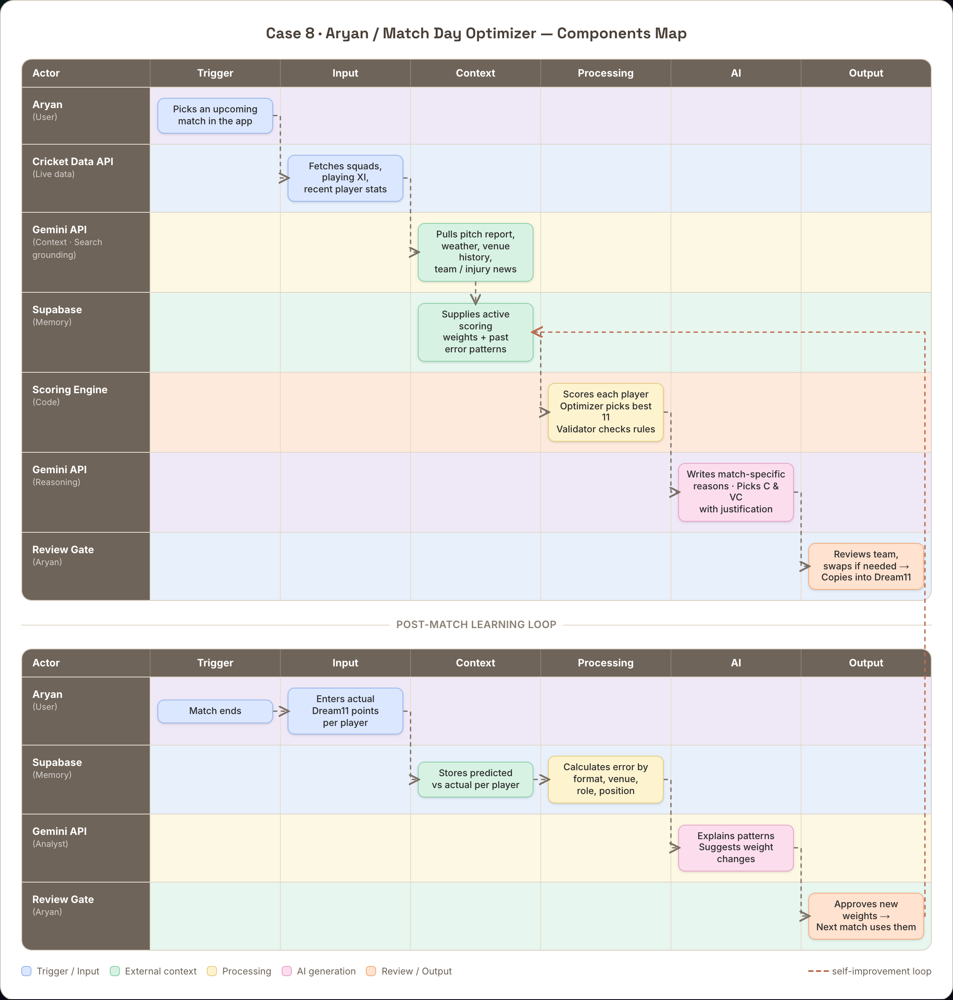

# Case 8 · Aryan / Match Day Optimizer — Components Map

The live, interactive version is at **`/components-map`** in the app. A rendered image is at `docs/components-map.png`.

## Match-day flow

| Actor (role) | Trigger | Input | Context | Processing | AI | Output |
|---|---|---|---|---|---|---|
| **Aryan** (User) | Picks an upcoming match in the app | | | | | |
| **Cricket Data API** (Live data) | | Fetches squads, playing XI, recent player stats | | | | |
| **Gemini API** (Context · Search grounding) | | | Pulls pitch report, weather, venue history, team / injury news | | | |
| **Supabase** (Memory) | | | Supplies active scoring weights + past error patterns | | | |
| **Scoring Engine** (Code) | | | | Scores each player with weights · Optimizer picks best 11 · Validator checks Dream11 rules | | |
| **Gemini API** (Reasoning) | | | | | Writes match-specific reasons · Picks C & VC with justification | |
| **Review Gate** (Aryan) | | | | | | Reviews team, swaps if needed → Copies into Dream11 |

## Post-match learning loop

| Actor (role) | Trigger | Input | Context | Processing | AI | Output |
|---|---|---|---|---|---|---|
| **Aryan** (User) | Match ends | Enters actual Dream11 points per player | | | | |
| **Supabase** (Memory) | | | Stores predicted vs actual per player | Calculates error by format, venue, role, position | | |
| **Gemini API** (Analyst) | | | | | Explains patterns · Suggests weight changes | |
| **Review Gate** (Aryan) | | | | | | Approves new weights → Next match uses them |

A dashed arrow runs from the final loop box back to the **Supabase (Memory)** box in the first grid, closing the self-improvement cycle: the weights Aryan approves become the active weights the next match is scored with.

### Legend

- **Blue** — trigger / input
- **Green** — external context
- **Yellow** — processing / triage
- **Pink** — AI generation
- **Peach** — review / output
